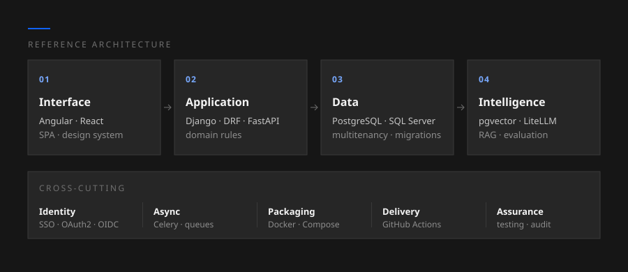
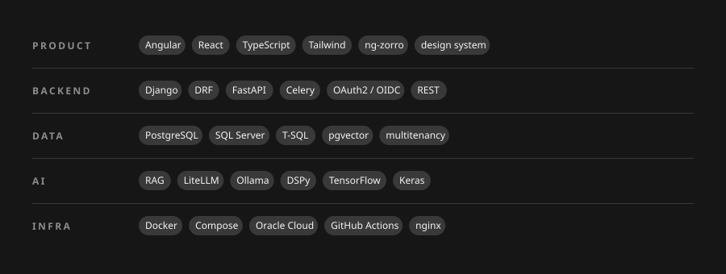

[Português](README.md) · **English**

I build systems end to end — data modeling, API, interface, infrastructure and AI models. I work mainly on management software for organizations operating under regulation: environments where every number must be auditable, access must be segmented, and generated documents must hold up formally.

I am completing a Computer Engineering degree at CEFET-MG, with research in computer vision applied to clinical signals.

## Systems

| Public Transparency Platform | Multitenant SaaS for public agencies |
|:--|:--|
| **What it does** | Consolidates external audit results and internal self-assessment, generates the diagnosis and the annual action plan, distributes responsibilities by department and deadline, records compliance evidence, and issues the official reports as PDFs. |
| **What it enables** | Replaces a manual cycle of spreadsheets, scattered documents and hand-written reports with a continuous, traceable flow. The team stops producing documents and starts executing a plan, with the history of every decision preserved for audit. |
| **Architecture** | Multitenant with per-organization isolation · asynchronous queue processing · server-side document generation · encryption at rest for sensitive data · in-house design system |
| **Stack** | `Django` `DRF` `PostgreSQL` `Celery` `Angular` `React` `Tailwind` `Docker` |

| Social Listening Module | Ombudsman, integrated into the transparency platform |
|:--|:--|
| **What it does** | Imports citizen case archives, proposes automatic classification by theme using a deterministic multi-label classifier, and monitors public portals, comparing what is published against what regulation requires. |
| **What it enables** | Triage that depended on manual reading now arrives pre-classified. Management can see what citizens most demand, by theme and period, and spot publication gaps before an auditor does. |
| **Architecture** | Ingestion pipeline normalizing heterogeneous formats · deterministic and auditable classification, no black box over decisions affecting citizens · automated collection with a headless browser · historical series per run |
| **Stack** | `Python` `Playwright` `PostgreSQL` `deterministic text processing` |

| Corporate ERP | Contracts, finance, tax and sales |
|:--|:--|
| **What it does** | Manages the contract lifecycle including amendments and adjustments across its term, computes commissions, issues and reconciles tax documents, and tracks the sales pipeline from prospecting to close. |
| **What it enables** | Replaces a patchwork of spreadsheets and disconnected systems with a single source of truth. Finance closes each period with traceability from the entry back to the originating contract, and sales can see what actually converted into revenue. |
| **Architecture** | Domain modeled in the database with controlled script versioning · layered API · SPA frontend · centralized SSO authentication with roles and permissions · separate environments with a deployment pipeline |
| **Stack** | `SQL Server` `T-SQL` `Django` `FastAPI` `React` `Docker` `OAuth2/OIDC` |

| AI Platform | Semantic search and assisted answering over an in-house corpus |
|:--|:--|
| **What it does** | Indexes documents as vector representations, answers questions citing the sources that support the answer, and recognizes when the corpus does not cover a question instead of inventing one. |
| **What it enables** | Knowledge locked in PDFs and in the heads of a few specialists becomes searchable in seconds, with the source always visible. And cost stays predictable: local inference where it fits, cloud only where it is needed. |
| **Architecture** | Vector database for semantic search · local inference on ARM servers · model gateway routing by data sensitivity tier · automated answer-quality evaluation · continuous delivery through a self-hosted runner |
| **Stack** | `FastAPI` `pgvector` `Ollama` `LiteLLM` `DSPy` `Oracle Cloud` `GitHub Actions` |

| Management Dashboards | From analytical prototype to production system |
|:--|:--|
| **What it does** | Consolidates data from corporate databases and management tools into role-based views, automatically scoped to the entity and profile of whoever is looking. |
| **What it enables** | Moves the indicator out of the monthly report and onto a live screen. Each manager sees exactly their own scope — and what was an analyst's prototype becomes a system with access control, tests and deployment, no longer dependent on whoever wrote it. |
| **Architecture** | Client/server separation · role- and entity-based authorization enforced in the backend · caching of expensive queries · full containerization · third-party API integration |
| **Stack** | `Angular` `Django` `SQL Server` `ng-zorro` `REST APIs` |

## Reference architecture

The pattern that recurs across the systems above — four domain layers and a set of cross-cutting concerns running through all of them.

## Stack

## How I work

| | |
|:--|:--|
| **Numbers never come from an LLM** | Numbers, scores and deadlines come from a deterministic, testable, auditable engine. AI goes where the answer is text, not where the answer is a consequence. |
| **Real data before done** | Synthetic tests prove the code runs; only real data proves the domain model is right. |
| **Round-trips before queries** | Slowness blamed on the network is almost always call architecture, not the execution plan. |
| **Isolation is verified screen by screen** | Modals included. "No entity assigned" must never mean "sees everything". |
| **An applied script is immutable** | A new parameter goes at the end of the signature — in the middle, it writes to the wrong column and raises nothing. |
| **Production build before commit** | Type checkers and test suites miss template errors; only the build catches them. |

## Research

| Synthetic ECG generation for rare diagnoses | Final thesis · Computer Engineering |
|:--|:--|
| **The problem** | Electrocardiogram datasets are severely imbalanced: the clinically most critical classes are precisely those with the fewest examples, and classifier recall collapses exactly where errors cost most. |
| **The approach** | Generate synthetic examples of the minority classes to rebalance training, and measure the real gain on the classifiers. |
| **The work** | Multi-label classification of 12-lead ECG treated as images · architectures with attention mechanisms and transfer learning · a purpose-built web panel to run the experiments, with A/B comparison, statistical significance testing, fidelity analysis of generated samples and visual inspection of exams. |
| **Stack** | `TensorFlow` `Keras` `Python` `Django` `React` `LaTeX` |

## Education

| Degree | Institution | Status |
|:--|:--|:--|
| Computer Engineering | CEFET-MG — Divinópolis campus | Completing |

## Contact

Open to **full stack and data/AI roles**, and to **project-based work**.

The systems described above were built under contract and their code is private. What is shown here is architecture and purpose, with no client identification or operational data — and I am glad to go deeper into technical decisions and trade-offs in conversation.

Interface built on the <a href="https://v10.carbondesignsystem.com/">IBM Carbon Design System v10</a>, Gray 100 theme, with IBM Plex typography.
