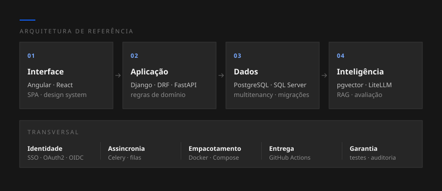
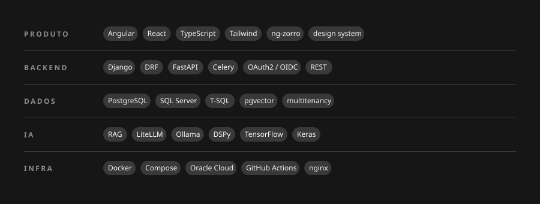

**Português** · [English](README.en.md)

Construo sistemas de ponta a ponta — modelagem de dados, API, interface, infraestrutura e modelos de IA. Trabalho principalmente com software de gestão para organizações que operam sob regulação: ambientes em que o número precisa ser auditável, o acesso precisa ser segmentado e o documento gerado precisa ter validade formal.

Fecho Engenharia de Computação no CEFET-MG, com pesquisa em visão computacional aplicada a sinais clínicos.

## Sistemas

| Plataforma de Transparência Pública | SaaS multitenant para órgãos públicos |
|:--|:--|
| **O que faz** | Consolida avaliação externa e autoavaliação interna, gera o diagnóstico e o plano anual de ação, distribui responsabilidades por setor e prazo, registra evidências de cumprimento e emite os relatórios oficiais em PDF. |
| **O que proporciona** | Substitui um ciclo manual de planilhas, documentos avulsos e relatórios redigidos à mão por um fluxo contínuo e rastreável. A equipe para de produzir documento e passa a executar plano, com o histórico de cada decisão preservado para auditoria. |
| **Arquitetura** | Multitenant com isolamento por organização · processamento assíncrono em fila · geração documental no servidor · cifra em repouso para dados sensíveis · design system próprio |
| **Stack** | `Django` `DRF` `PostgreSQL` `Celery` `Angular` `React` `Tailwind` `Docker` |

| Módulo de Escuta Social | Ouvidoria, integrado à plataforma de transparência |
|:--|:--|
| **O que faz** | Importa acervos de manifestações do cidadão, propõe classificação automática por tema com um classificador determinístico multirrótulo, e monitora portais públicos comparando o que está publicado com o que a norma exige. |
| **O que proporciona** | Triagem que dependia de leitura manual passa a chegar pré-classificada. A gestão enxerga o que o cidadão mais demanda, por tema e por período, e identifica lacunas de publicação antes que a fiscalização as encontre. |
| **Arquitetura** | Pipeline de ingestão com normalização de formatos heterogêneos · classificação determinística e auditável, sem caixa-preta sobre decisão que afeta cidadão · coleta automatizada com navegador headless · série histórica por rodada |
| **Stack** | `Python` `Playwright` `PostgreSQL` `processamento de linguagem determinístico` |

| ERP corporativo | Contratos, financeiro, fiscal e comercial |
|:--|:--|
| **O que faz** | Controla o ciclo de vida do contrato com aditivos e reajustes ao longo da vigência, apura comissionamento, emite e concilia documentos fiscais, e acompanha o funil comercial da prospecção ao fechamento. |
| **O que proporciona** | Troca um conjunto de planilhas e sistemas isolados por uma fonte única de verdade. O financeiro fecha competência com rastreabilidade do lançamento até o contrato de origem, e a área comercial enxerga o que de fato virou receita. |
| **Arquitetura** | Domínio modelado no banco com versionamento controlado de scripts · API em camadas · SPA no frontend · autenticação centralizada por SSO com papéis e permissões · ambientes separados com esteira de deploy |
| **Stack** | `SQL Server` `T-SQL` `Django` `FastAPI` `React` `Docker` `OAuth2/OIDC` |

| Plataforma de IA | Busca semântica e resposta assistida sobre acervo próprio |
|:--|:--|
| **O que faz** | Indexa documentos em representações vetoriais, responde perguntas citando a base que sustentou a resposta, e reconhece quando a base não cobre a pergunta em vez de inventar. |
| **O que proporciona** | Conhecimento preso em PDFs e na cabeça de poucos especialistas vira consultável em segundos, com a fonte sempre à vista. E o custo fica previsível: inferência local onde cabe, nuvem apenas onde é necessário. |
| **Arquitetura** | Banco vetorial para busca semântica · inferência local em servidores ARM · gateway de modelos com roteamento por nível de sensibilidade do dado · avaliação automatizada da qualidade das respostas · entrega contínua por runner self-hosted |
| **Stack** | `FastAPI` `pgvector` `Ollama` `LiteLLM` `DSPy` `Oracle Cloud` `GitHub Actions` |

| Dashboards de gestão | Do protótipo analítico ao sistema de produção |
|:--|:--|
| **O que faz** | Consolida dados de bancos corporativos e de ferramentas de gestão em visões por papel, com recorte automático por entidade e perfil de quem está olhando. |
| **O que proporciona** | Tira o indicador do relatório mensal e coloca na tela, atualizado. Cada gestor vê exatamente o seu escopo — e o que era protótipo de analista vira sistema com controle de acesso, testes e deploy, sem depender de quem o escreveu. |
| **Arquitetura** | Separação cliente/servidor · autorização por papel e por entidade aplicada no backend · cache das consultas pesadas · containerização completa · integração com APIs de terceiros |
| **Stack** | `Angular` `Django` `SQL Server` `ng-zorro` `REST APIs` |

## Arquitetura de referência

O padrão que se repete nos sistemas acima — quatro camadas de domínio e um conjunto de preocupações transversais que atravessa todas elas.

## Stack

## Como eu trabalho

| | |
|:--|:--|
| **Número não sai de LLM** | Número, selo e prazo saem de engine determinístico, testável e auditável. IA entra onde a resposta é texto, não onde a resposta é consequência. |
| **Dado real antes de pronto** | Teste sintético prova que o código roda; só dado real prova que o modelo do domínio está certo. |
| **Round-trips antes de query** | Lentidão atribuída à rede quase sempre é arquitetura de chamada, não plano de execução. |
| **Isolamento se verifica tela a tela** | Modais incluídos. "Sem entidade atribuída" nunca pode significar "vê tudo". |
| **Script aplicado é imutável** | Parâmetro novo vai no fim da assinatura — no meio, ele grava no campo errado e não levanta erro nenhum. |
| **Build de produção antes do commit** | Verificador de tipos e suíte de testes não pegam erro de template; só o build pega. |

## Pesquisa

| Geração de ECG sintético para diagnósticos raros | Trabalho de conclusão · Engenharia de Computação |
|:--|:--|
| **O problema** | Datasets de eletrocardiograma são severamente desbalanceados: as classes clinicamente mais críticas são justamente as que têm menos exemplos, e o recall dos classificadores desaba exatamente onde errar custa mais. |
| **A proposta** | Gerar exemplos sintéticos das classes minoritárias para reequilibrar o treino, e medir o ganho real sobre os classificadores. |
| **O trabalho** | Classificação multirrótulo de ECG de 12 derivações tratado como imagem · arquiteturas com mecanismos de atenção e transfer learning · painel web próprio para conduzir os experimentos, com comparação A/B, teste de significância estatística, análise de fidelidade das amostras e inspeção visual dos exames. |
| **Stack** | `TensorFlow` `Keras` `Python` `Django` `React` `LaTeX` |

## Formação

| Curso | Instituição | Situação |
|:--|:--|:--|
| Engenharia de Computação | CEFET-MG — campus Divinópolis | Em conclusão |

## Contato

Aberto a **oportunidades full stack e de dados/IA**, e a **projetos sob demanda**.

Os sistemas descritos acima foram desenvolvidos sob contrato e seu código é privado. O que está aqui é a arquitetura e o propósito, sem identificação de clientes ou dados de operação — e posso aprofundar decisões técnicas e trade-offs em conversa.

Interface construída sobre o <a href="https://v10.carbondesignsystem.com/">IBM Carbon Design System v10</a>, tema Gray 100, com tipografia IBM Plex.
